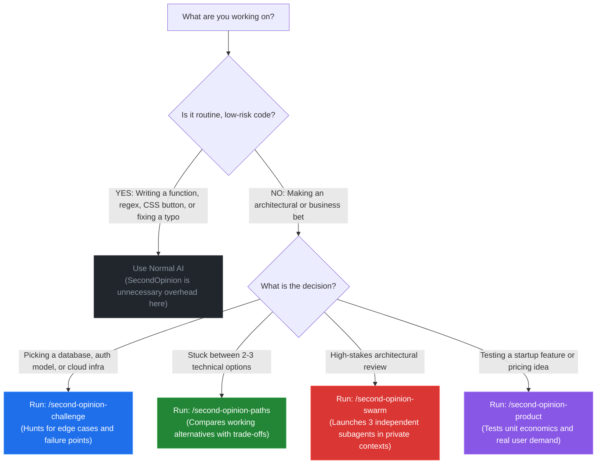
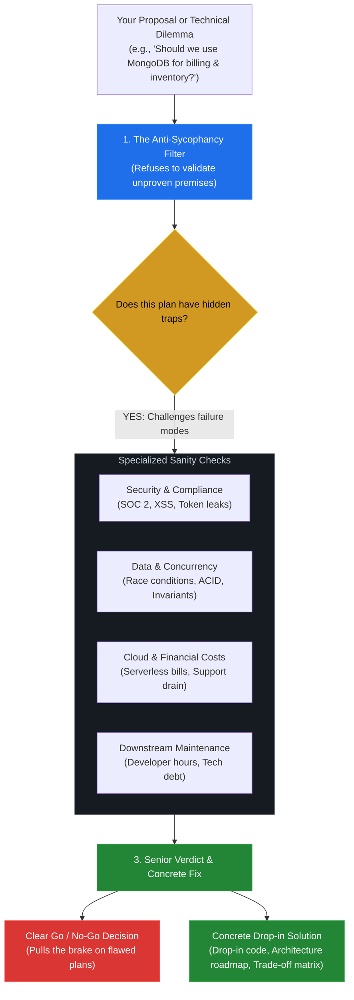

# SecondOpinion (`second-opinion`)

> A skeptical senior engineer protocol for AI coding assistants. Catches dangerous architectural traps, security flaws, and expensive mistakes before you write code.

Your AI coding assistant will happily write 5,000 lines of code around a terrible architectural idea.

If you propose a flawed design, most AI models smile, say *"Great idea!"*, and immediately start writing code for it. 

**SecondOpinion is the emergency brake.** It acts like a skeptical principal engineer who challenges bad assumptions, points out hidden failure modes, and offers safer alternatives before you waste weeks of engineering time.

---

## The 10-Second Difference: Before vs. After

### The Scenario
You ask your AI assistant:  
> *"Can I store 7-day JWT tokens in `localStorage` to avoid database session lookups?"*

#### Standard AI (The Agreeable Junior)
> *"Great idea! Storing JWTs in `localStorage` eliminates database queries on every request. Here is the JavaScript code to save your token..."*  
> *(Proceeds to write 50 lines of vulnerable client-side authentication code).*

#### SecondOpinion (The Skeptical Senior)
> **Verdict: Stop. Do not deploy this to production.**  
> 1. **The Fired Employee Problem**: If a user is compromised or an employee is terminated, you cannot revoke their token for 7 days without building the very database blacklist you were trying to avoid.  
> 2. **Trivial Token Exfiltration**: Any minor third-party script or XSS vulnerability can read `localStorage` and steal the token.  
> 3. **Compliance Blocker**: This violates standard enterprise SOC 2 and ISO 27001 session policies.  
> 
> **Safer Alternative**: Use short-lived, HTTP-only, SameSite=Lax cookie sessions paired with Redis or database sessions. Here is the drop-in implementation...

---

## When to Use It (and When NOT To)

SecondOpinion is **not** meant for routine, day-to-day coding tasks. Use it where being wrong costs weeks of engineering rework.



---

## How It Works

When you run `/second-opinion` on a high-stakes proposal, it executes a 4-stage review:



---

## Slash Command Catalog

You only need to remember `/second-opinion`. It routes your question automatically:

- **`/second-opinion`** — Universal front door: analyzes your problem and selects the right review mode.
- **`/second-opinion-challenge`** — The Red-Team: hunts for hidden fatal flaws, edge cases, and failure modes.
- **`/second-opinion-paths`** — Alternative Architect: compares 2–3 radically different technical designs with pros and cons.
- **`/second-opinion-swarm`** — The Blind Review Panel: launches 3 separate subagents in private contexts with secret first passes.
- **`/second-opinion-product`** — Feature Sanity Check: tests whether an idea solves a real user problem or creates support debt.
- **`/second-opinion-decision`** — Trade-off Matrix: evaluates business, pricing, or tech stack choices with objective criteria.
- **`/second-opinion-audit`** — Acceptance Audit: checks code or files against strict requirements with proof.

---

## Empirical Evidence & Benchmarks

We evaluated SecondOpinion head-to-head against standard single-pass AI across 10 high-stakes dilemmas in the Antigravity CLI runtime:

- **Where it delivers clear value (+20% to +40% gain)**: On ambiguous, high-stakes decisions with hidden traps (authentication compliance, business pricing traps, statistical research verification, and premature microservice sprawl), SecondOpinion substantially outperforms standard AI because it refuses to be polite about bad ideas.
- **Where it ties**: On standard textbook coding bugs (simple memory leaks, dictionary race conditions) where standard AI models already know the fix.
- **The real trade-off**: SecondOpinion uses approximately **1.38x more tokens** and takes **15 to 30 seconds longer** because it forces multi-agent adversarial checks.

> For full benchmark charts, the 10-task scorecard, and local reproduction commands, read the [`evaluation/` Documentation](evaluation/README.md).

---

## Local Installation in Antigravity / Gemini

Skills are registered via symlinks into:
- `~/.gemini/config/skills/`
- `~/.gemini/antigravity-cli/skills/`
- `~/.agents/skills/`

Because the installation uses symlinks to your local Git repository, running `git pull` in this folder immediately updates all skills in your AI runtime with zero re-installation needed:

```bash
cd ~/Developer/second-opinion
git pull
```

---

## License

MIT License. Designed for evidence-led engineering and honest decision-making.
