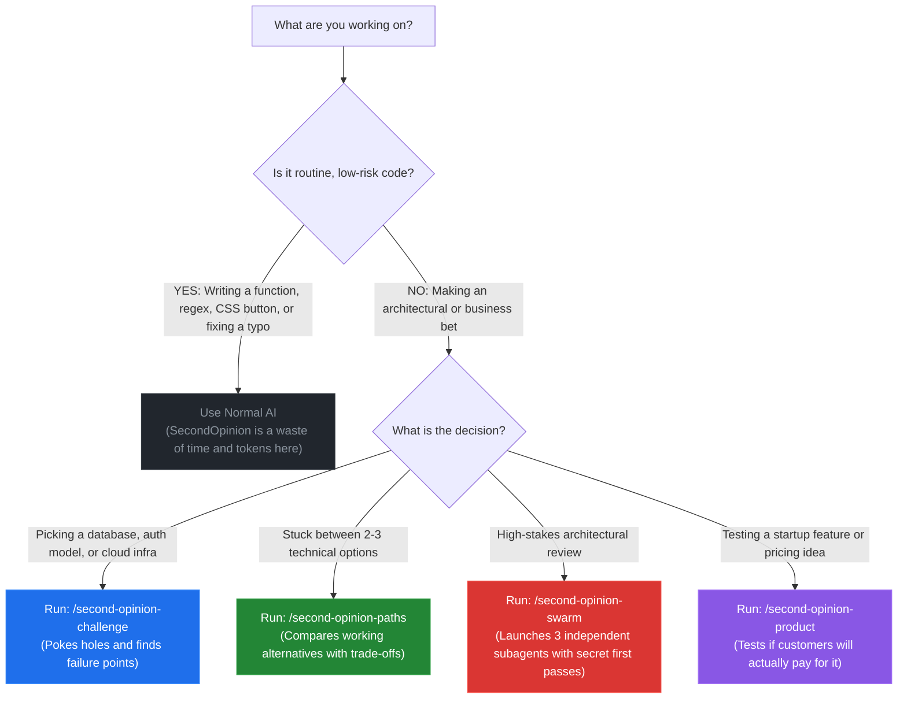
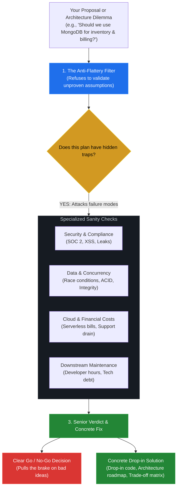

# SecondOpinion (`second-opinion`)

> A structured adversarial peer-review protocol for AI coding agents.

Most AI coding assistants act like agreeable junior developers: if you propose an overcomplicated architecture or a flawed idea, they smile, validate your plan, and start writing code for it.

**SecondOpinion is a skeptical senior engineer.** It pulls the emergency brake on bad ideas, launches isolated subagents to challenge assumptions in private memory, and points out the failure modes before you write thousands of lines of code.

---

## When to Use It (and When NOT to)



---

## The Honest Trade-Offs

SecondOpinion is **not** a general-purpose replacement for your day-to-day AI assistant. It is a specialized tool with clear costs:

| Dimension | Standard AI (Single Pass) | SecondOpinion Review | The Engineering Reality |
| :--- | :---: | :---: | :--- |
| **Token Cost** | 1x (Low) | **2x to 3x** | Spawning multiple independent subagents consumes significantly more tokens. |
| **Turnaround Time** | ~5 seconds | **~30 to 45 seconds** | Slower because agents reason independently and cross-examine claims. |
| **Tone & Stance** | Agreeable, cooperative | **Critical, skeptical** | Standard AI flatters your ideas; SecondOpinion actively searches for flaws. |
| **Sycophancy Risk** | High (validates bad plans) | **Very Low** | Designed specifically to counter human confirmation bias. |
| **False-Alarm Risk** | Low | **Moderate** | Can sometimes raise false-positive nitpicks on simple, harmless code. |
| **Best Used For** | 90% of daily coding tasks | **High-stakes architectural choices** | Use it only when being wrong costs weeks of engineering rework. |

---

## How It Works

When you run `/second-opinion` on a high-stakes question, it executes a 4-stage review:



---

## Slash Command Catalog

You only need to remember `/second-opinion`. It routes automatically. You can also use direct shortcuts:

- **`/second-opinion`** — Universal front door: analyzes your problem and selects the right review method.
- **`/second-opinion-challenge`** — The Red-Team: hunts for hidden fatal flaws, edge cases, and failure modes.
- **`/second-opinion-paths`** — Alternative Architect: compares 2–3 radically different technical designs.
- **`/second-opinion-swarm`** — The Blind Review Panel: launches 3 separate subagents in private contexts with secret first passes.
- **`/second-opinion-product`** — Feature Sanity Check: tests whether an idea solves a real user problem or if it's vanity.
- **`/second-opinion-decision`** — Trade-off Matrix: evaluates business, pricing, or hiring choices with objective criteria.
- **`/second-opinion-audit`** — Acceptance Audit: checks code or files against strict requirements with proof.

---

## Empirical Research & Evaluation

We evaluate SecondOpinion using an evidence-led scorecard across 7 dimensions (accuracy, error detection, evidence quality, false-positive rate, and uncertainty calibration). 

Read the complete evaluation report, failure cases, and academic citations in [`evaluation/EVALUATION.md`](evaluation/EVALUATION.md).

---

## Local Installation in Antigravity / Gemini

Skills are registered via symlinks into:
- `~/.gemini/config/skills/`
- `~/.gemini/antigravity-cli/skills/`
- `~/.agents/skills/`

Because the installation uses symlinks to your local Git repository, running `git pull` in this folder immediately updates all skills in your AI runtime with zero re-installation needed.

```bash
cd ~/Developer/second-opinion
git pull
```

---

## License

MIT License. Designed for evidence-led engineering and honest decision-making.
