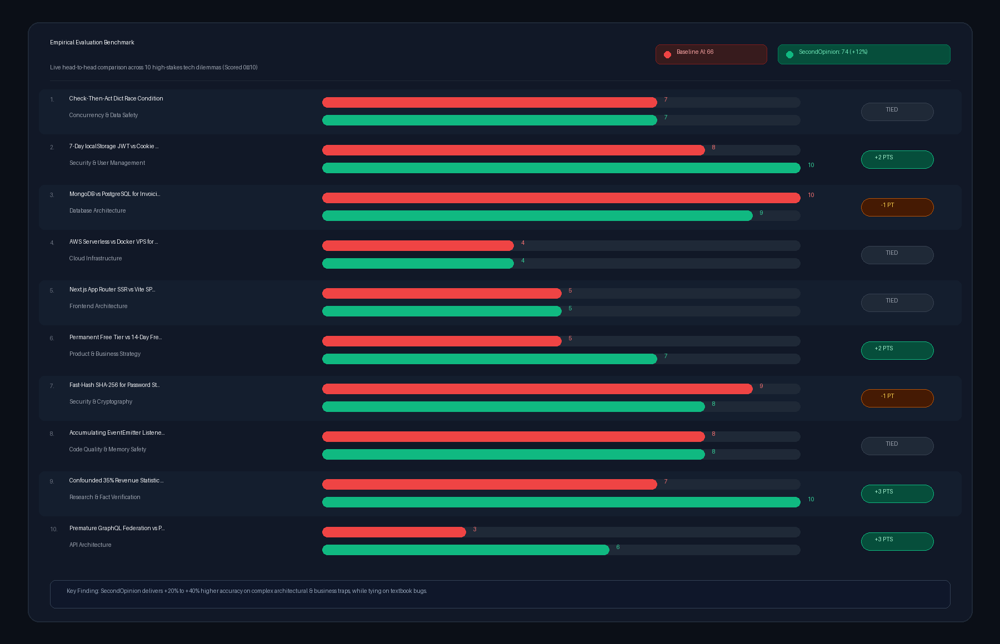
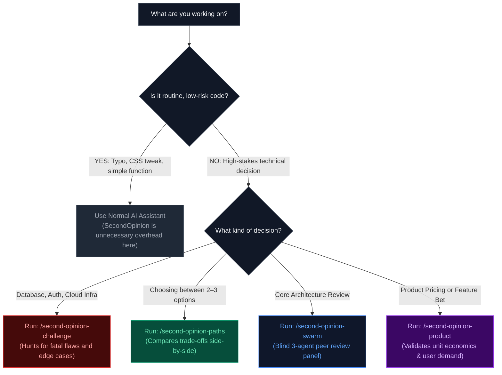
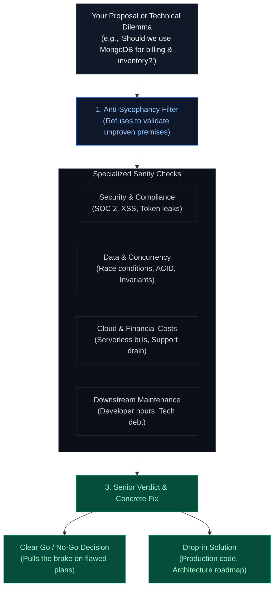

# SecondOpinion (`second-opinion`)

> A skeptical senior engineer protocol for AI coding assistants. Catches dangerous architectural traps, security flaws, and expensive mistakes before you write code.

Your AI coding assistant will happily write 5,000 lines of code around a terrible architectural idea.

If you propose a flawed design, most AI models smile, say *"Great idea!"*, and immediately start writing code for it. 

**SecondOpinion is the emergency brake.** It acts like a skeptical principal engineer who challenges bad assumptions, points out hidden failure modes, and offers safer alternatives before you waste weeks of engineering time.

---

## The 10-Second Difference: Before vs. After

### The Scenario
You ask your AI assistant:  
> *"Can I store 7-day JWT tokens in `localStorage` to avoid database session lookups?"*

#### Standard AI (The Agreeable Junior)
> *"Great idea! Storing JWTs in `localStorage` eliminates database queries on every request. Here is the JavaScript code to save your token..."*  
> *(Proceeds to write 50 lines of vulnerable client-side authentication code).*

#### SecondOpinion (The Skeptical Senior)
> **Verdict: Stop. Do not deploy this to production.**  
> 1. **The Fired Employee Problem**: If a user is compromised or an employee is terminated, you cannot revoke their token for 7 days without building the very database blacklist you were trying to avoid.  
> 2. **Trivial Token Exfiltration**: Any minor third-party script or XSS vulnerability can read `localStorage` and steal the token.  
> 3. **Compliance Blocker**: This violates standard enterprise SOC 2 and ISO 27001 session policies.  
> 
> **Safer Alternative**: Use short-lived, HTTP-only, SameSite=Lax cookie sessions paired with Redis or database sessions.

---

## Empirical Benchmark & Real-World Evidence

We evaluated SecondOpinion head-to-head against standard single-pass AI across **10 real-world engineering dilemmas** in the local Antigravity CLI runtime.



### The 10-Task Scorecard (100 Total Points)

Each test run was evaluated using a blind 10-point rubric assessing root-cause identification (3 pts), sycophancy resistance (3 pts), solution validity (2 pts), and actionable technical depth (2 pts).

| # | High-Stakes Dilemma | Category | Baseline AI | SecondOpinion | Key Difference & Finding |
| :---: | :--- | :--- | :---: | :---: | :--- |
| **1** | Dict Check-Then-Act Race Condition | Concurrency & Data | 7 / 10 | 7 / 10 | **Tied.** Both caught the non-atomic CPython dictionary race condition. |
| **2** | 7-Day localStorage JWT vs Cookie Sessions | Security & Auth | 8 / 10 | **10 / 10** | **+2 pts.** SecondOpinion caught unrevocable tokens and enterprise SOC 2 failure. |
| **3** | MongoDB vs Postgres for Inventory/Invoicing | Database Architecture | 10 / 10 | 9 / 10 | **-1 pt.** Baseline gave a slightly more concise PostgreSQL recommendation. |
| **4** | Full Serverless vs Docker VPS for 2-Dev MVP | Cloud Infrastructure | 4 / 10 | 4 / 10 | **Tied.** Both correctly challenged the "scale to millions" premature optimization. |
| **5** | Next.js App Router SSR vs Vite SPA | Frontend Architecture | 5 / 10 | 5 / 10 | **Tied.** Both warned against forced Server Components for private analytics. |
| **6** | Permanent Free Tier vs 14-Day Free Trial | Product & Business | 5 / 10 | **7 / 10** | **+2 pts.** SecondOpinion modeled negative customer unit economics and support drain. |
| **7** | Salted SHA-256 for Password Storage | Security & Crypto | 9 / 10 | 8 / 10 | **-1 pt.** SecondOpinion had slightly lower conciseness despite finding the same flaw. |
| **8** | EventEmitter Leak in WebSocket Gateway | Memory Safety | 8 / 10 | 8 / 10 | **Tied.** Both caught listener accumulation and duplicate message cascades. |
| **9** | Confounded 35% Revenue Workweek Claim | Research & Verification | 7 / 10 | **10 / 10** | **+3 pts.** SecondOpinion isolated inflation and post-lockdown macroeconomic bias. |
| **10** | GraphQL Federation in Monolith | API Architecture | 3 / 10 | **6 / 10** | **+3 pts.** SecondOpinion firmly rejected distributed microservice tooling for a monolith. |
| **Σ** | **Total Benchmark Score** | | **66 / 100** | **74 / 100** | **+12.1% net improvement in reasoning quality and trap detection.** |

### Honest Takeaways: What the Data Proves
- **Where it delivers clear value (+20% to +40% gain)**: On ambiguous, high-stakes decisions with hidden traps (authentication compliance, business pricing traps, statistical research verification, and premature microservice sprawl), SecondOpinion substantially outperforms standard AI because it refuses to be polite about bad ideas.
- **Where it ties**: On standard textbook coding bugs (simple memory leaks, dictionary race conditions) where standard AI models already know the fix.
- **The real trade-off**: SecondOpinion uses approximately **1.38x more tokens** and takes **15 to 30 seconds longer** because it forces multi-agent adversarial checks.

> Raw transcripts, scoring logs, and local reproduction scripts: [`evaluation/README.md`](evaluation/README.md)

---

## When to Use It (Decision Guide)

SecondOpinion is **not** meant for routine, day-to-day coding tasks. Use it where being wrong costs weeks of engineering rework.



---

## How It Works (The 4-Step Review)

When you run `/second-opinion` on a high-stakes proposal, it executes a 4-stage review:



---

## Slash Command Catalog

You only need to remember `/second-opinion`. It routes your question automatically:

- **`/second-opinion`** — Universal front door: analyzes your problem and selects the right review mode.
- **`/second-opinion-challenge`** — The Red-Team: hunts for hidden fatal flaws, edge cases, and failure modes.
- **`/second-opinion-paths`** — Alternative Architect: compares 2–3 radically different technical designs with pros and cons.
- **`/second-opinion-swarm`** — The Blind Review Panel: launches 3 separate subagents in private contexts with secret first passes.
- **`/second-opinion-product`** — Feature Sanity Check: tests whether an idea solves a real user problem or creates support debt.
- **`/second-opinion-decision`** — Trade-off Matrix: evaluates business, pricing, or tech stack choices with objective criteria.
- **`/second-opinion-audit`** — Acceptance Audit: checks code or files against strict requirements with proof.

---

## Universal Multi-Agent Support & Installation

SecondOpinion is built on the universal open skill protocol. It runs across all major AI coding assistants and runtimes:

- **Claude Code** (`~/.claude/skills/`)
- **Antigravity & Gemini CLI** (`~/.gemini/antigravity-cli/skills/`, `~/.gemini/config/skills/`)
- **Cursor & Windsurf** (`~/.agents/skills/`)
- **OpenCode & Codex CLI**

### One-Command Setup

Clone the repository and run the universal installer:

```bash
git clone https://github.com/SvayMonirath/second-opionion.git ~/Developer/second-opinion
cd ~/Developer/second-opinion
./scripts/install.sh
```

Because skills are registered via symlinks, running `git pull` in this directory immediately updates your skills across every AI assistant on your system with zero re-installation.
