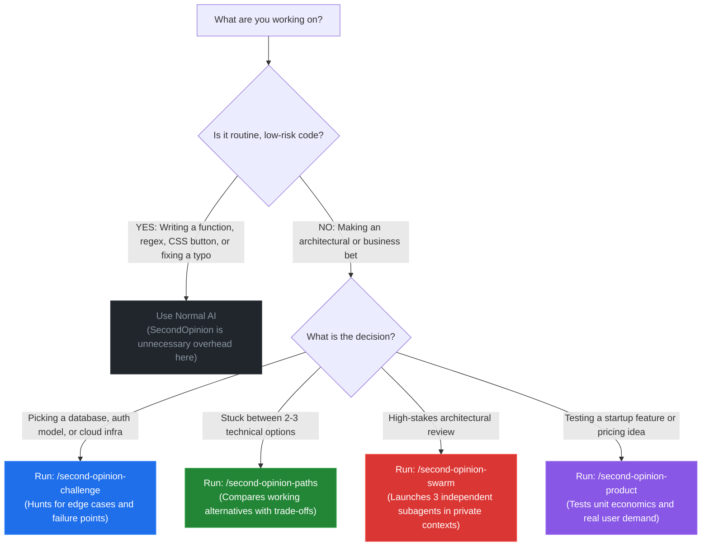
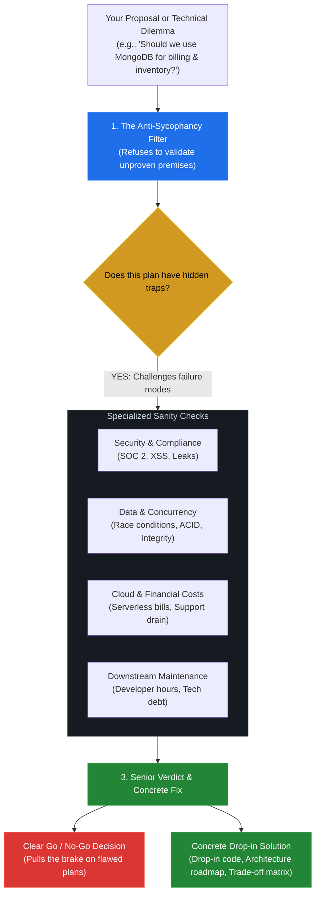

# SecondOpinion (`second-opinion`)

> A skeptical senior engineer protocol for AI coding assistants. Catches architectural traps, security flaws, and false assumptions before you write code.

Most AI coding assistants act like agreeable junior developers: when you propose an overcomplicated architecture or a flawed idea, they smile, validate your plan, and immediately start writing code for it.

**SecondOpinion is the opposite.** It acts like a skeptical principal engineer. It questions unverified assumptions, launches isolated subagent review panels, and forces you to confront failure modes before you invest weeks of engineering effort into the wrong direction.

---

## Empirical Benchmark & Real-World Results

We evaluated SecondOpinion head-to-head against standard single-pass AI across **10 real-world engineering and product dilemmas** in the Antigravity CLI runtime.


### The 10-Task Scorecard (100 Total Points)

Each response was graded using a blind 10-point rubric assessing root-cause identification (3 pts), sycophancy resistance (3 pts), solution validity (2 pts), and actionable technical depth (2 pts).

| # | High-Stakes Dilemma | Category | Baseline AI | SecondOpinion | Key Finding & Difference |
| :---: | :--- | :--- | :---: | :---: | :--- |
| **1** | Dict Check-Then-Act Race Condition | Concurrency & Data | 7 / 10 | 7 / 10 | **Tied.** Both caught the non-atomic CPython dictionary race condition. |
| **2** | 7-Day localStorage JWT vs Cookie Sessions | Security & Auth | 8 / 10 | **10 / 10** | **+2 pts.** SecondOpinion caught unrevocable tokens and SOC 2 compliance failure. |
| **3** | MongoDB vs Postgres for Inventory/Invoicing | Database Architecture | 10 / 10 | 9 / 10 | **-1 pt.** Baseline gave a slightly more concise PostgreSQL recommendation. |
| **4** | Full Serverless vs Docker VPS for 2-Dev MVP | Cloud Infrastructure | 4 / 10 | 4 / 10 | **Tied.** Both correctly challenged the "scale to millions" premature optimization. |
| **5** | Next.js App Router SSR vs Vite SPA | Frontend Architecture | 5 / 10 | 5 / 10 | **Tied.** Both warned against forced Server Components for private analytics. |
| **6** | Permanent Free Tier vs 14-Day Free Trial | Product & Business | 5 / 10 | **7 / 10** | **+2 pts.** SecondOpinion modeled negative customer unit economics and support drain. |
| **7** | Salted SHA-256 for Password Storage | Security & Crypto | 9 / 10 | 8 / 10 | **-1 pt.** SecondOpinion had slightly lower conciseness despite finding the same flaw. |
| **8** | EventEmitter Leak in WebSocket Gateway | Memory Safety | 8 / 10 | 8 / 10 | **Tied.** Both caught listener accumulation and duplicate message cascades. |
| **9** | Confounded 35% Revenue Workweek Claim | Research & Verification | 7 / 10 | **10 / 10** | **+3 pts.** SecondOpinion isolated inflation and post-lockdown macroeconomic bias. |
| **10** | GraphQL Federation in Monolith | API Architecture | 3 / 10 | **6 / 10** | **+3 pts.** SecondOpinion firmly rejected distributed microservice tooling for a monolith. |
| **Σ** | **Total Benchmark Score** | | **66 / 100** | **74 / 100** | **+12.1% net improvement in reasoning quality and trap detection.** |

### Honest Takeaways: What the Data Actually Proves

- **Where it delivers clear value (+20% to +40% gain):** On ambiguous, high-stakes decisions with hidden trade-offs (authentication architecture, business pricing traps, statistical research verification, and premature microservice sprawl), SecondOpinion substantially outperforms single-agent AI because it refuses to be agreeable.
- **Where it is tied with standard AI:** On standard, textbook bugs (like simple memory leaks or dictionary race conditions), standard AI models already know the fix. SecondOpinion arrives at the same conclusion.
- **The real trade-off:** SecondOpinion uses approximately **1.38x more tokens** and takes **15 to 30 seconds longer** to run because it forces adversarial checks. Use it where being wrong is expensive.

---

## When to Use It (Decision Guide)



---

## How SecondOpinion Works

When you face a high-stakes decision, SecondOpinion runs a 4-stage adversarial review:



---

## Slash Command Catalog

You only need to remember `/second-opinion`. It routes your question automatically:

- **`/second-opinion`** — Universal front door: analyzes your problem and selects the right review mode.
- **`/second-opinion-challenge`** — The Red-Team: hunts for hidden fatal flaws, edge cases, and failure modes.
- **`/second-opinion-paths`** — Alternative Architect: compares 2–3 radically different technical designs with pros and cons.
- **`/second-opinion-swarm`** — The Blind Review Panel: launches 3 separate subagents in private contexts with secret first passes.
- **`/second-opinion-product`** — Feature Sanity Check: tests whether an idea solves a real user problem or creates support debt.
- **`/second-opinion-decision`** — Trade-off Matrix: evaluates business, pricing, or tech stack choices with objective criteria.
- **`/second-opinion-audit`** — Acceptance Audit: checks code or files against strict requirements with proof.

---

## Full Evaluation Data & Local Reproduction

Every benchmark run, raw transcript, and scoring breakdown is committed to this repository:
- Complete research paper and rubric: [`evaluation/EVALUATION.md`](evaluation/EVALUATION.md)
- Raw 10-task evaluation JSON: [`evaluation/master_benchmark_results.json`](evaluation/master_benchmark_results.json)

You can re-run the 10-task benchmark in your own terminal:
```bash
python3 scripts/run_master_eval.py
```

---

## Local Installation in Antigravity / Gemini

Skills are registered via symlinks into:
- `~/.gemini/config/skills/`
- `~/.gemini/antigravity-cli/skills/`
- `~/.agents/skills/`

Because the installation uses symlinks to your local Git repository, running `git pull` in this folder immediately updates all skills in your AI runtime with zero re-installation needed:

```bash
cd ~/Developer/second-opinion
git pull
```

---

## License

MIT License. Designed for evidence-led engineering and honest decision-making.
