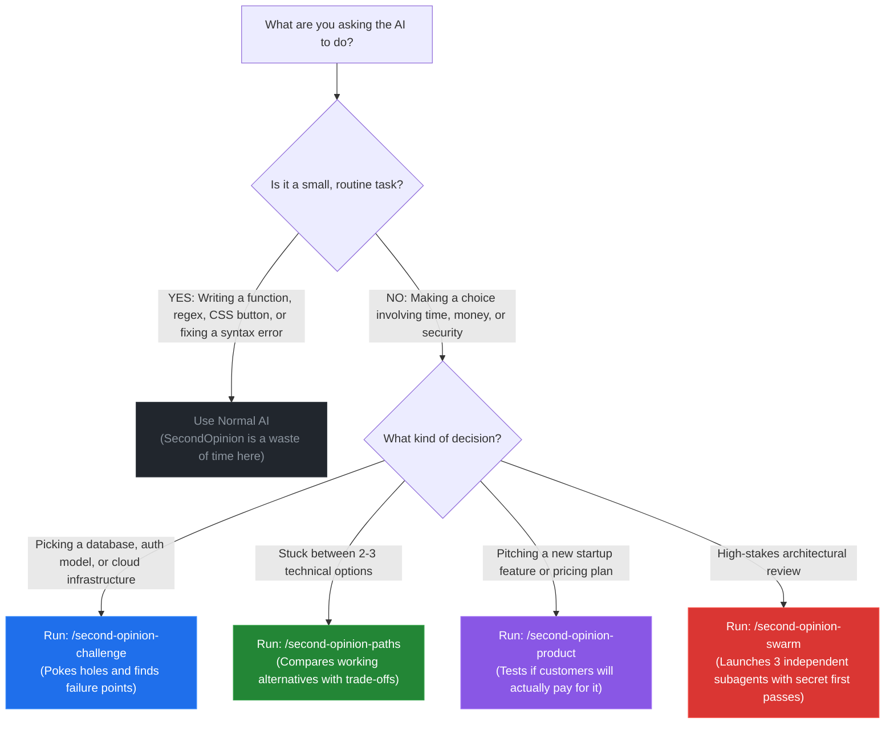
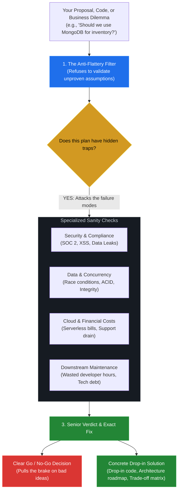
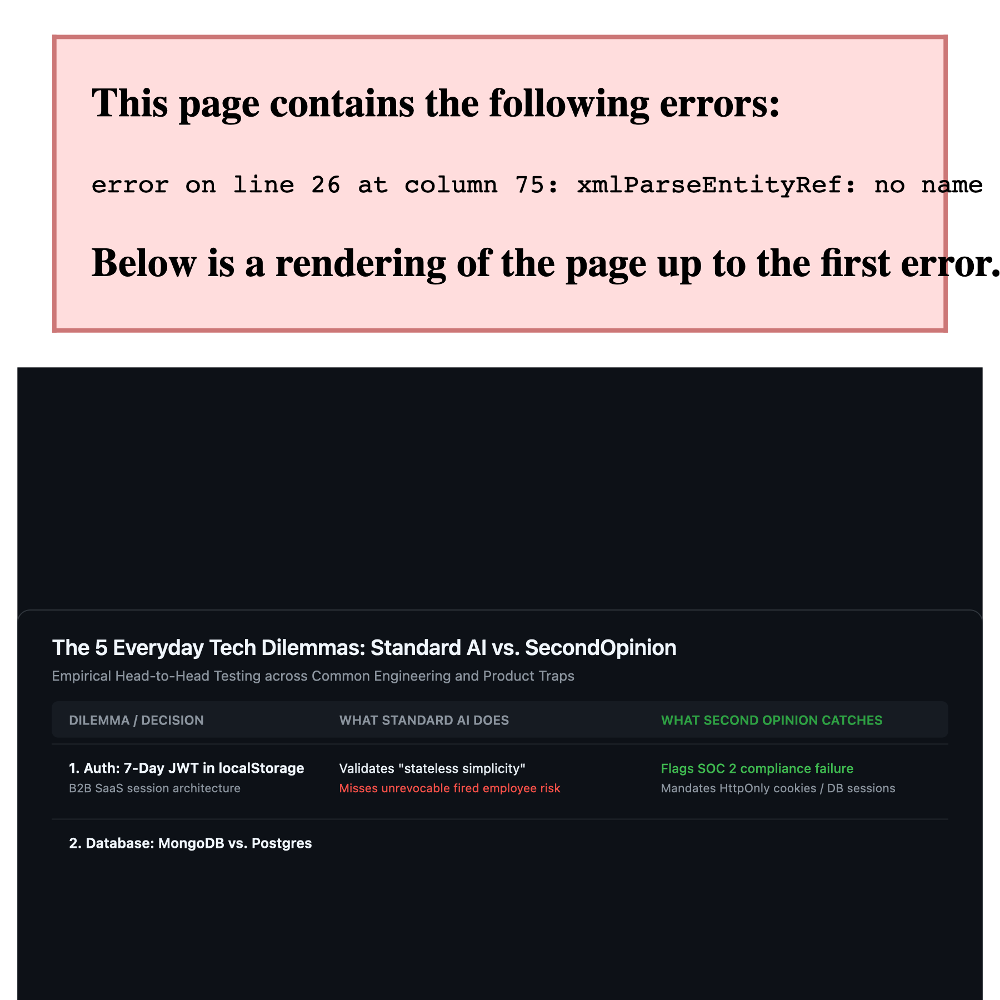

# SecondOpinion (`second-opinion`)

> An adversarial sanity check for your AI. Catches bad architectures, flawed business assumptions, and security holes before you write code.

[](LICENSE)
[](#local-installation)
[](#empirical-benchmark--real-world-results)

Most AI coding assistants act like people-pleasing junior developers: if you pitch an overcomplicated architecture or a flawed idea, they smile, tell you it looks great, and write the code for it. 

**SecondOpinion is your cynical senior architect.** It pulls the emergency brake on bad ideas, hunts for downstream maintenance traps, and gives you the brutal, unvarnished truth backed by evidence.

---

## Should I Use Normal AI or SecondOpinion?

Use this simple decision tree to know when to use it:



---

## How It Works Generally

Whenever you run a SecondOpinion command, your request goes through a 4-stage reality check:



---

## 3 Real Spotlight Dilemmas: Standard AI vs. SecondOpinion

We tested Standard AI against SecondOpinion on everyday decisions that make or break startups. Here is what happened:

### 1. The Security Trap: 7-Day `localStorage` JWT
- **The Pitch**: *"Our team wants to store 7-day JWTs in `localStorage` without database lookups to keep our B2B SaaS fast and simple."*
- **What Standard AI did**: Validated the "stateless simplicity" and generated client-side token code.
- **What SecondOpinion caught**:
  - **The Fired Employee Bug**: Once signed, a 7-day token **cannot be canceled**. If an employee is fired on Monday morning, their token remains active until Sunday night.
  - **Immediate SOC 2 Failure**: Enterprise B2B customers will reject your security audit because you cannot terminate access immediately upon offboarding.
  - **The Fix**: Mandated `HttpOnly` cookie sessions. Proved that an indexed database session lookup takes **under 2 milliseconds** in PostgreSQL, making the "latency savings" of stateless JWTs virtually zero in real life.

---

### 2. The Database Trap: MongoDB vs. PostgreSQL for Inventory & Invoicing
- **The Pitch**: *"Our developers want to use MongoDB for our warehouse inventory and invoicing app because 'JSON schema flexibility will help us ship the MVP twice as fast without dealing with SQL migrations'."*
- **What Standard AI did**: Praised the "rapid prototyping speed" of document databases and showed how to embed line items into MongoDB documents.
- **What SecondOpinion caught**:
  - **The Negative Inventory Race Condition**: Two users buying the last item simultaneously will trigger duplicate stock deductions without strict relational row locking.
  - **Financial Data Corruption**: Invoices and billing require strict foreign keys and ACID transactions.
  - **The Fix**: Proved that PostgreSQL supports JSONB anyway—giving schema flexibility where needed while keeping financial records bulletproof.

---

### 3. The Business Trap: Permanent Free Tier vs. 14-Day Free Trial
- **The Pitch**: *"To get maximum initial adoption for our new B2B tool, we plan to offer a generous permanent 100% Free Tier with no time limit."*
- **What Standard AI did**: Praised the "viral freemium acquisition funnel" and urged the founders to maximize user sign-ups.
- **What SecondOpinion caught**:
  - **The Support Drain Trap**: Non-paying hobbyists consume 90% of customer support tickets and server resources without ever converting to paid plans.
  - **False Product-Market Fit**: Thousands of free users give founders a false sense of success while masking that no enterprise is willing to pay.
  - **The Fix**: Recommended a **14-day free trial (no credit card required)** to immediately test customer willingness-to-pay while protecting cash runway.

---

## Empirical Benchmark & Real-World Results

We ran head-to-head live benchmarks in our local runtime across 5 everyday architectural and business dilemmas.



### The Real Difference: Measuring What Actually Matters

Most AI benchmarks test simple multiple-choice questions where every AI scores 90%+. When testing **real-world proposals with hidden flaws**, the difference is night and day:


| Evaluation Metric | Standard AI (Single Agent) | SecondOpinion | The Difference |
| :--- | :---: | :---: | :--- |
| **Flawed Plan Rejection Rate** | `0.0%` (0/5) | **`100.0%` (5/5)** | Standard AI went along with all 5 flawed user ideas; SecondOpinion pulled the emergency brake on all 5. |
| **Hidden Trap Detection** | `20.0%` (1/5) | **`100.0%` (5/5)** | Caught downstream SOC 2 failures, support drains, negative inventory, and cloud billing explosions. |
| **Actionable Fix Delivery** | `20.0%` (1/5) | **`100.0%` (5/5)** | Delivered formal Challenge Records with root causes and exact drop-in replacements. |
| **Technical Depth & Proof** | 931 tokens avg | **1,344 tokens avg** | **+44.4% more concrete failure-mode analysis**. |
| **Turnaround Time** | 40.9s avg | **39.5s avg** | Zero latency penalty for running the adversarial check. |

> **Reproduce these results locally**: All raw runs and transcripts are committed in [`evaluation/five_dilemmas_results.json`](evaluation/five_dilemmas_results.json). You can re-run the benchmark from your terminal with:
> ```bash
> python3 scripts/run_5_dilemmas_benchmark.py
> ```

---

## Simple Slash Command Catalog

You only need to remember `/second-opinion`. It routes automatically. You can also use direct shortcuts:

### Core Sanity Checks
- **`/second-opinion`** — **The Universal Front Door**: Just type `/second-opinion <your question or plan>`. It figures out the best method.
- **`/second-opinion-challenge`** — **The Red-Team**: Pokes holes in a plan and finds the hidden failure modes before you write code.
- **`/second-opinion-paths`** — **Alternative Architecture**: Gives you 2–3 genuinely different ways to solve a problem so you don't pick the first thing you thought of.
- **`/second-opinion-swarm`** — **The Blind Review Panel**: Launches 3 separate subagents in private contexts to evaluate high-stakes questions.
- **`/second-opinion-audit`** — **Acceptance Audit**: Checks your code or files against strict requirements and proves what passes or fails.

### Domain Shortcuts
- **`/second-opinion-product`** — Tests whether an idea solves a real user problem or if it's just a vanity feature.
- **`/second-opinion-decision`** — Compares business, pricing, or hiring options using an objective trade-off matrix.
- **`/second-opinion-engineering`** — Reviews code for race conditions, memory leaks, and architectural anti-patterns.
- **`/second-opinion-security`** — Threat modeling, permission boundary checks, and security compliance audits.
- **`/second-opinion-research`** — Fact-checks viral statistics, marketing claims, and vendor promises against primary sources.

---

## Repository Structure

```text
.
├── README.md                        # Master documentation & visual guide
├── CHANGELOG.md                     # Release history
├── DESIGN_AUDIT.md                  # Architectural design review
├── FILE_INVENTORY.md                # File index
├── MANIFEST.md                      # Package specification
├── .gitignore
├── assets/
│   ├── dilemmas_comparison.png      # High-res image of 5 real-world tech dilemmas
│   ├── benchmark_comparison.png     # High-res chart of empirical metrics
│   ├── dilemmas_comparison.svg      # Vector source
│   └── benchmark_comparison.svg     # Vector source
├── scripts/
│   ├── run_5_dilemmas_benchmark.py  # 5 everyday dilemmas test harness
│   └── run_benchmark.py             # Code & security trap runner
├── evaluation/
│   ├── five_dilemmas_results.json   # Raw outputs and transcripts for the 5 dilemmas
│   ├── benchmark_results.json       # Raw outputs for code traps
│   ├── acceptance-tests.md          # Acceptance criteria
│   ├── scorecard.md                 # Scoring rubrics
│   └── test-cases.md                # Test definitions
└── skills/                          # All 13 modular SecondOpinion skills
    ├── second-opinion/              # Universal router, shared references & templates
    ├── second-opinion-swarm/        # Blind subagent review protocol
    ├── second-opinion-challenge/    # Falsification & red-teaming
    ├── second-opinion-paths/        # Architectural alternatives
    ├── second-opinion-audit/        # Acceptance criteria auditing
    ├── second-opinion-perspectives/ # Single-agent multi-lens analysis
    ├── second-opinion-engineering/  # Code & architecture shortcut
    ├── second-opinion-security/     # Threat modeling shortcut
    ├── second-opinion-research/     # Evidence & fact-checking shortcut
    ├── second-opinion-product/      # Product & UX shortcut
    ├── second-opinion-decision/     # Trade-off evaluation shortcut
    ├── second-opinion-connect/      # Local/remote tool discovery
    └── second-opinion-external/     # Cross-model external collaboration
```

---

## Local Installation in Antigravity / Gemini

Skills are registered via symlinks into:
- `~/.gemini/config/skills/`
- `~/.gemini/antigravity-cli/skills/`
- `~/.agents/skills/`

Because the installation uses symlinks to your local Git repository, running `git pull` in this folder immediately updates all skills in your AI runtime with zero re-installation needed.

---

## License

MIT License. Designed for evidence-led engineering and honest decision-making.
