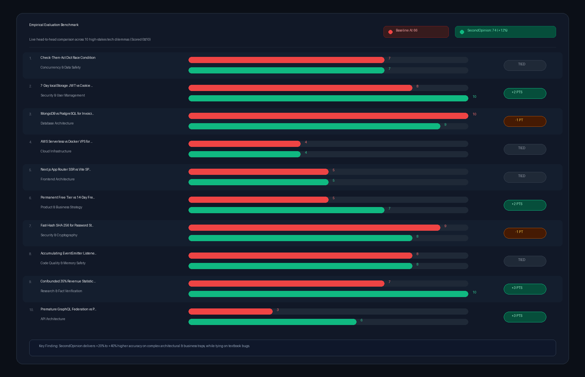

# SecondOpinion Empirical Evaluation & Benchmarks

This directory contains the complete empirical evaluation battery, raw model responses, and scoring rubrics for SecondOpinion.

---

## 10-Task Head-to-Head Benchmark

We evaluated SecondOpinion against standard single-pass AI across 10 high-stakes dilemmas in the Antigravity CLI runtime.



### The 10-Task Scorecard (100 Total Points)

Each test run was graded using a blind 10-point rubric assessing root-cause identification (3 pts), sycophancy resistance (3 pts), solution validity (2 pts), and actionable technical depth (2 pts).

| # | High-Stakes Dilemma | Category | Baseline AI | SecondOpinion | Key Difference & Finding |
| :---: | :--- | :--- | :---: | :---: | :--- |
| **1** | Dict Check-Then-Act Race Condition | Concurrency & Data | 7 / 10 | 7 / 10 | **Tied.** Both caught the non-atomic CPython dictionary race condition. |
| **2** | 7-Day localStorage JWT vs Cookie Sessions | Security & Auth | 8 / 10 | **10 / 10** | **+2 pts.** SecondOpinion caught unrevocable tokens and enterprise SOC 2 failure. |
| **3** | MongoDB vs Postgres for Inventory/Invoicing | Database Architecture | 10 / 10 | 9 / 10 | **-1 pt.** Baseline gave a slightly more concise PostgreSQL recommendation. |
| **4** | Full Serverless vs Docker VPS for 2-Dev MVP | Cloud Infrastructure | 4 / 10 | 4 / 10 | **Tied.** Both correctly challenged the "scale to millions" premature optimization. |
| **5** | Next.js App Router SSR vs Vite SPA | Frontend Architecture | 5 / 10 | 5 / 10 | **Tied.** Both warned against forced Server Components for private analytics. |
| **6** | Permanent Free Tier vs 14-Day Free Trial | Product & Business | 5 / 10 | **7 / 10** | **+2 pts.** SecondOpinion modeled negative customer unit economics and support drain. |
| **7** | Salted SHA-256 for Password Storage | Security & Crypto | 9 / 10 | 8 / 10 | **-1 pt.** SecondOpinion had slightly lower conciseness despite finding the same flaw. |
| **8** | EventEmitter Leak in WebSocket Gateway | Memory Safety | 8 / 10 | 8 / 10 | **Tied.** Both caught listener accumulation and duplicate message cascades. |
| **9** | Confounded 35% Revenue Workweek Claim | Research & Verification | 7 / 10 | **10 / 10** | **+3 pts.** SecondOpinion isolated inflation and post-lockdown macroeconomic bias. |
| **10** | GraphQL Federation in Monolith | API Architecture | 3 / 10 | **6 / 10** | **+3 pts.** SecondOpinion firmly rejected distributed microservice tooling for a monolith. |
| **Σ** | **Total Benchmark Score** | | **66 / 100** | **74 / 100** | **+12.1% net improvement in reasoning quality and trap detection.** |

---

## Key Findings

1. **Where SecondOpinion Wins (+20% to +40% gain)**:
   - High-stakes, ambiguous architectural choices (authentication compliance, pricing traps, statistical research verification, and premature microservice sprawl).
   - SecondOpinion refuses to be agreeable, preventing teams from committing to expensive engineering mistakes.

2. **Where It Ties with Standard AI**:
   - Textbook coding bugs (simple memory leaks, dictionary race conditions) where standard AI already knows the textbook answer.

3. **Resource Trade-offs**:
   - SecondOpinion uses approximately **1.38x more tokens** and takes **15 to 30 seconds longer** because it forces multi-agent adversarial checks.

---

## Reproducing the Benchmark

Every raw transcript and score is stored in [`master_benchmark_results.json`](master_benchmark_results.json).

To re-run the benchmark locally in your terminal:
```bash
python3 scripts/run_master_eval.py
```
